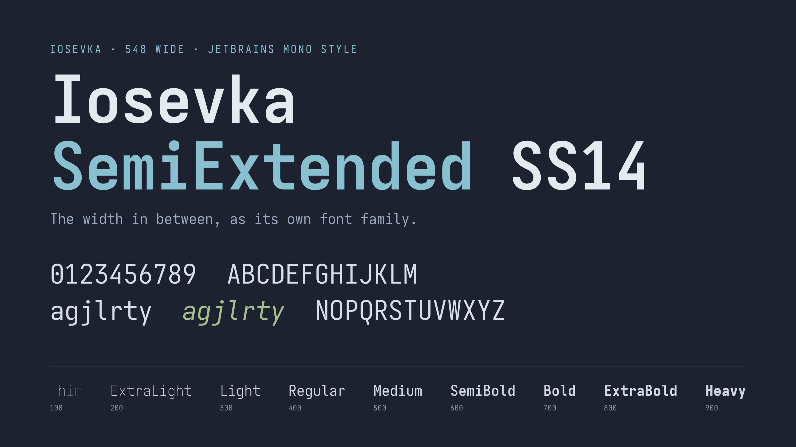
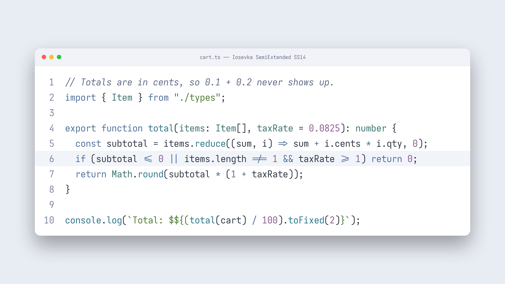
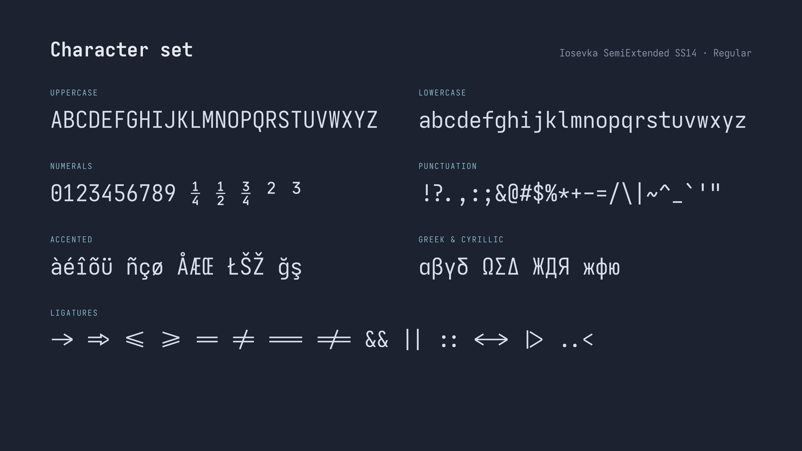

# Iosevka SemiExtended



[Iosevka](https://github.com/be5invis/Iosevka), unmodified, in the SemiExtended width (548). The release builds ship Normal and Extended only ([be5invis/Iosevka#3320](https://github.com/be5invis/Iosevka/issues/3320)), so this repo builds two release plans in the SemiExtended width and packages each as a Homebrew cask. Each gets its own family name, so `Iosevka` and `Iosevka SS14` stay the standard width and font menus list the SemiExtended builds separately:

| Cask | Family | Built from |
| --- | --- | --- |
| `font-iosevka-semi-extended` | `Iosevka SemiExtended` | the release `Iosevka` plan |
| `font-iosevka-semi-extended-ss14` | `Iosevka SemiExtended SS14` | the release `IosevkaSS14` plan (JetBrains Mono style) |

Each has all 9 weights in upright, italic and oblique.

<picture>
  <source media="(prefers-color-scheme: dark)" srcset="images/code-dark.png">
  
</picture>



## Install

```bash
brew install --cask probablyian/iosevka-semi-extended/font-iosevka-semi-extended
```

```bash
brew install --cask probablyian/iosevka-semi-extended/font-iosevka-semi-extended-ss14
```

Set the font family to the name in the table. The fonts install next to Homebrew's `font-iosevka` and `font-iosevka-ss14` without clashing. Without Homebrew, download the zip from [Releases](../../releases) and copy the `.ttf` files to `~/Library/Fonts` (macOS) or `~/.local/share/fonts` (Linux, then run `fc-cache -f`).

## Stylistic sets

`Iosevka SemiExtended` keeps the character variants and stylistic sets (`cv01`–`cv99`, `ss01`–`ss20`), so an editor can pick a style. For JetBrains Mono style (`ss14`):

| App | Setting |
| --- | --- |
| Ghostty | `font-feature = ss14` |
| Zed | `"buffer_font_features": { "ss14": true }` |
| VS Code | `"editor.fontLigatures": "'calt', 'ss14'"` |
| VS Code terminal | `"terminal.integrated.fontLigatures.enabled": true` and `"terminal.integrated.fontLigatures.featureSettings": "'calt', 'ss14'"` |

`Iosevka SemiExtended SS14` has the JetBrains Mono style built in and, like the release SS14 fonts, leaves out the `cv` and `ss` switches, so it needs no settings.

## Updates

A daily workflow builds each new Iosevka release with [`private-build-plans.toml`](private-build-plans.toml), publishes the zips, and bumps both casks, so `brew upgrade` picks it up. To build a specific tag, run the **Build** workflow by hand with that tag.

## License

The fonts are under the SIL Open Font License 1.1, and `LICENSE.md` ships in every zip.
